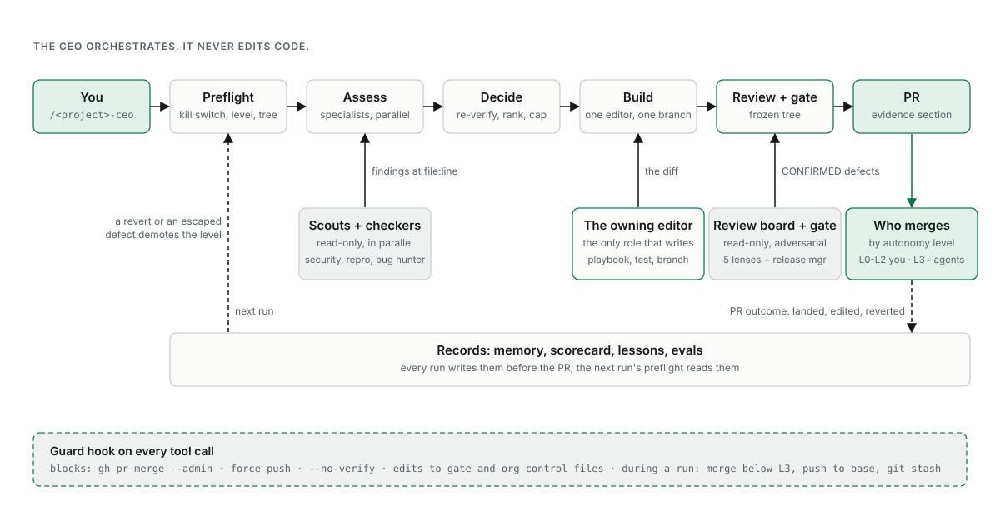

# agent-org

**A Claude Code agent team, generated from your repo, that earns autonomy on evidence.**

[](LICENSE)
[](.claude-plugin/plugin.json)
[](.github/workflows/test.yml)
[](#development)
[](https://github.com/BbekShr/agent-org/stargazers)

Agents find bugs, fix them and open PRs. **You merge** until the org's track record says
otherwise. Reviewers can't edit code, a guard hook blocks the shortcuts, and every miss a human
catches becomes a test the agents must pass from then on.

[Website](https://bbekshr.github.io/agent-org/) · [Docs](https://bbekshr.github.io/agent-org/docs.html) · [Report a bug](https://github.com/BbekShr/agent-org/issues/new/choose)

## Quick start

```
/plugin marketplace add BbekShr/agent-org
/plugin install agent-org@agent-org

# then, inside your repo:
/org-init                 # reads the repo, asks up to 4 questions, works on a branch
/<project>-ceo audit      # first run: a read-only board report, changes nothing
```

Install takes about 4 seconds. Stop everything at any time with `touch .claude/ceo/PAUSE`.

## How a run works

<picture>
  <source media="(prefers-color-scheme: dark)" srcset="docs/assets/flow-dark.svg">
  
</picture>

Three rules hold the whole thing up:

1. **Only builders write code.** One editor per code area. The CEO, the scouts, the reviewers
   and the release manager have no edit tools, so nobody grades their own work.
2. **Green gates are necessary, not sufficient.** Every diff faces an adversarial review board
   (one reviewer per lens) and the release gate together, on a frozen tree.
3. **Trust is earned.** An org starts at L0 or L1. Promotion needs scorecard evidence and your
   say-so; a revert demotes it on its own. Only you raise the level.

## The team and its models

The diagram shows the team `/org-init` generates for a standard Next.js + Supabase app with a
few bots. Roles come from the repo's real seams; the model comes from the job: judgment calls
(design critique, the read-only plan for a hard item) run on the top tier, building and
reviewing on the mid tier, the mechanical release gate on the small tier. Defaults are
top = `opus`, mid = `sonnet`, small = `haiku`; `/org-init` asks before fixing them.

A small library gets three agents (`core-engineer`, `security-engineer`, `release-manager`); a
large repo with public issues adds `researcher`, `architect`, `bug-hunter` and `rnd`. The full
catalog and the signals that pick each role are in
[`roster.md`](skills/org-init/references/roster.md).

| Level | Unlocks | Who merges |
|---|---|---|
| L0 Observe | Audits, discovery, proposals (records-only PRs) | you |
| L1 Verify | Fix PRs, one at a time | you |
| L2 Constrain | Scheduled headless runs | you |
| L3 Parallelize | Parallel worktrees | agents, for green PRs off protected paths; you sample |
| L4 Cloud | Always-on cloud routines | as L3 |

## Does it work?

`/org-eval` tests the agents like code: check out the commit before a real fix, run the agent,
and have a different model score the answer. First case, on photobari: the generated reviewer
scored **10/10** on a gesture bug a human had found by hand, and found three more defects the
later fix addressed. Without the org's lessons, the same reviewer scored 5/10. One case is a data
point, not a benchmark.

agent-org is distilled from four production agent orgs (a 19k-entry web directory, an AI travel
app, a photo-sharing app, a chart library). It was generated from scratch for an open-source
job-search pipeline and adopted into photobari, a hand-built org with 29 merged CEO PRs and 0 reverts.

## CEO modes

`/<project>-ceo <mode>`. Every mode starts with preflight and ends with a report; the apply
modes end at a PR. The autonomy level decides which modes are open.

| Mode | Does | Edits? | From |
|---|---|---|---|
| `audit` | Read-only pass by the report-only specialists: a board report, nothing changed | no | L0 |
| `light` (default) | Fast assess, then fix the top 1 to 3 items | PR | L1 |
| `deep` | Every specialist, every finding surfaced, fixes batched by owner | PR | L1 |
| `<ID>` | One named backlog item through the full pipeline | PR | L1 |
| `request "<ask>"` | Plain words from anyone, engineer or not, into a spec, then built | PR | L1 |
| `triage "<bug>"` | Reproduce a bug report on main first; then confirm fixed, file it, or fix it | records, or PR | L0 |
| `discover` | Hunt and file new bugs, one area and one lens at a time; `discover fix` also fixes them | records (`fix`: PRs) | L0 (`fix`: L3) |
| `rnd` | Propose features and process changes with evidence; never builds in the same run | records | L0 |
| `issues` | Triage open GitHub issues through the untrusted-input screen into backlog items | records | L0 |
| `e2e` | Drive the running app: find, fix, re-drive, ship. Local only, never production | PR | L1 |

`discover`, `rnd`, `issues` and `e2e` are optional; `/org-init` asks which to include.

## Commands

| Command | Does |
|---|---|
| `/org-init` | Generate an org for the current repo (`adopt` an existing one, `upgrade` to newer templates) |
| `/org-doctor` | Static health check of the org |
| `/org-eval [agent] [--blind]` | Grade agents on known-answer cases; `mine` drafts cases from history |
| `/org-feedback` | Opt-in: send template findings back to agent-org, project details stripped |
| `/<project>-ceo [mode]` | The CEO; modes above |
| `/<project>-verify` | Run, drive and inspect the real software |

The team, the guard, memory, evals, generated files and `org.json` are all in the
[docs](https://bbekshr.github.io/agent-org/docs.html).

## Development

```bash
python3 -m unittest discover tests
claude plugin validate .
```

The guard and doctor are standard-library Python, so they run in any project, whatever its
language. Without the plugin system, clone the repo and run `./install.sh`. The website lives in
`docs/` (static HTML and CSS on GitHub Pages).

<details>
<summary><b>Credits</b></summary>

agent-org stands on other people's work.

- **Four production agent orgs** built by the author (a web directory, an AI travel app, a
  photo-sharing app, a chart library): the CEO pattern, the run cycle, and most of the
  incident-backed rules.
- **Lauren Tan ([@poteto](https://github.com/poteto))**: the trust-curve approach to agent
  autonomy from her talks on running large agent teams (verification before autonomy, evals as
  unit tests for skills, enforcing rules at the strongest layer, a feature map for UI navigation,
  and the cloud bug-triage and runtime-inspection patterns behind `triage` and
  `/<project>-verify`), and [noodle](https://github.com/poteto/noodle) (the architect, skeptic and
  minimalist review lenses, "encode lessons in structure before notes", and the layout of this
  project's docs site).
- **[gstack](https://github.com/garrytan/gstack)** by Garry Tan: prior art for role-based Claude
  Code setups with a CEO and an engineering team.
- **[taste-skill](https://github.com/Leonxlnx/taste-skill)** (MIT) guided the website's design;
  **[ponytail](https://github.com/DietrichGebert/ponytail)** (MIT) is the simplicity bar the generated
  editors load.
- **[Geist](https://github.com/vercel/geist-font)** fonts (OFL-1.1) via Fontsource, and
  **[shields.io](https://shields.io)** badges.
- Built with and for **[Claude Code](https://www.anthropic.com/claude-code)**.

</details>

Bug reports, template findings and fixes are welcome: see [CONTRIBUTING.md](CONTRIBUTING.md).
[MIT](LICENSE). If this is useful, a ⭐ helps others find it.
